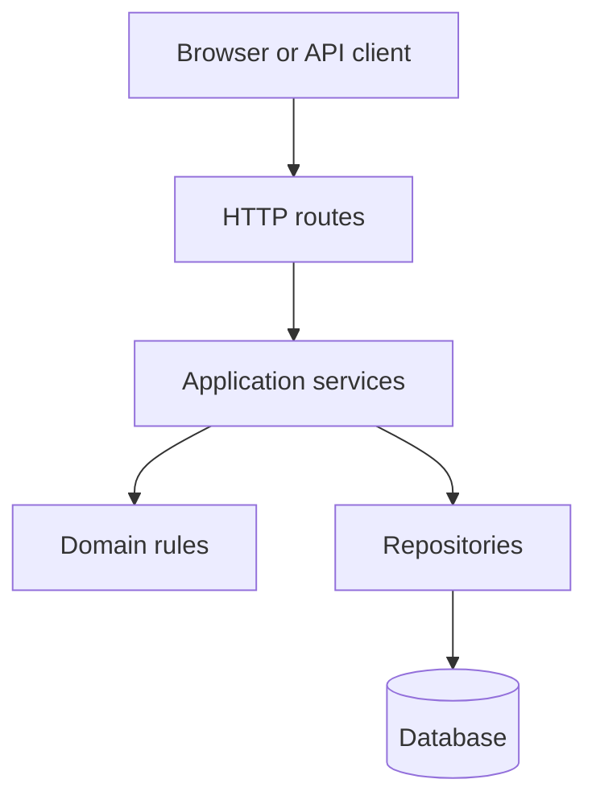
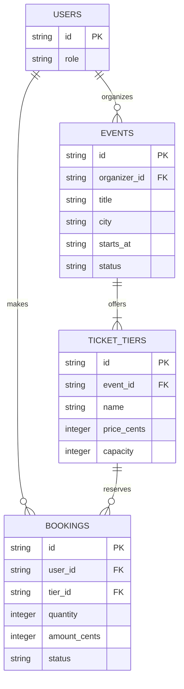
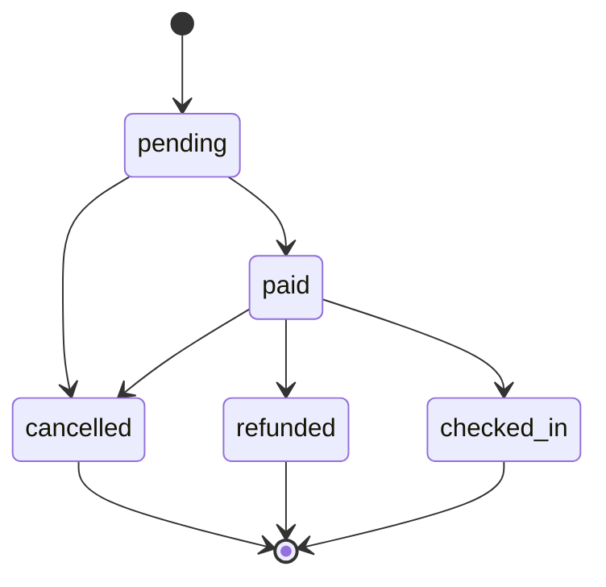

# Architecture

## Layers

- **Routes** may parse HTTP input, call a service, and format its response; they may not contain business rules or access storage directly.
- **Services** may coordinate domain rules and repositories; they may not depend on HTTP request or response objects.
- **Domain rules** may validate and transform domain data; they may not perform I/O or call services, routes, or repositories.
- **Repositories** may read and write persistence; they may not decide business policy or call services and routes.
- **Database** stores data; it does not call application layers.

## Data model

## Booking life cycle

`cancelled`, `refunded`, and `checked_in` are final states. No transition leaves them.